# DogCatTrace

**中文** · [English](README.md)

> **这是一个玩笑项目（Joke project），不是研究工具。**
>
> 用「数字分布相似度 + 闭集 softmax」这类公式去判定某个模型是否蒸馏自另一个模型或模型族，是可笑的。相似不等于同源。本仓库把这套数学一步不改地跑完，就是为了让这个缺口露出来。
>
> 仓库里的「品种」「品种族」「蒸馏」全是道具。数字是合成的，待测样本是虚构的，指纹库里的 24 个品种不存在。任何一个百分数都不构成对任何真实模型的判断。

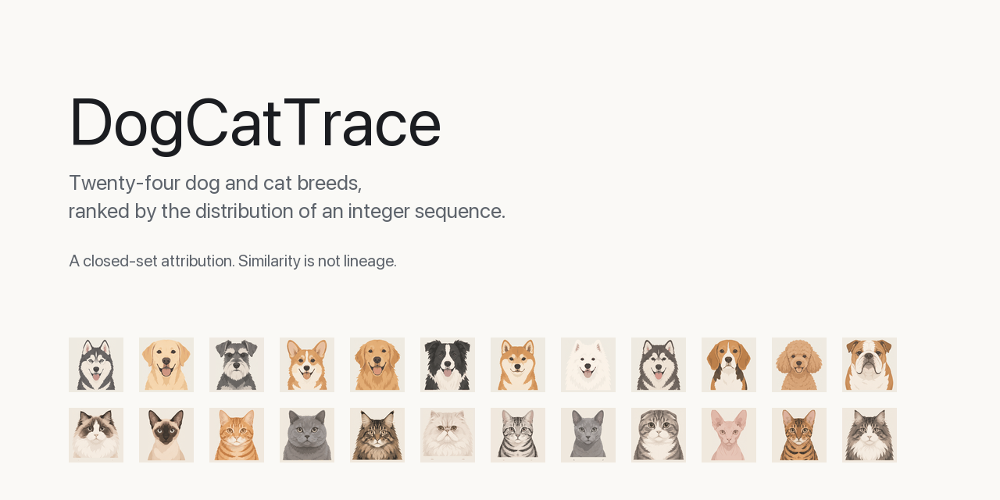

  

DogCatTrace 是一个品种归因工具。它通过三条独立的整数生成挑战提取输出指纹，在统一候选库中自动判断狗猫品种族与具体品种。

## 测一测你的模型是猫猫系还是狗狗系

三条挑战，三串随机整数，贴回来。你的模型是猫猫系还是狗狗系，顺带拿到一个品种人设。

**怎么玩**

1. 从页面复制三条挑战，原样发给你的模型。
2. 让它凭第一反应给出那串 1 到 355 的整数，不许调工具。
3. 把三份输出贴回页面，出结果。

**结果怎么看**

品种族是猫猫系还是狗狗系。犬族是狗狗系，猫族是猫猫系。具体品种就是你模型的二次元人设。

| 品种 | 族 | 人设 |
|---|---|---|
| 哈士奇 | 狗狗系 | 元气过头，尾巴摇成螺旋桨，喊一声能回你三声 |
| 拉布拉多 | 狗狗系 | 版本号涨了，沉稳没涨多少，见熟人照样原地起跳 |
| 雪纳瑞 | 狗狗系 | 训练有素的精英犬，指令听得懂，没人看着就拆家 |
| 柯基 | 狗狗系 | 腿短但自信，见谁都亲，被猫凶一下就躲你身后 |
| 金毛 | 狗狗系 | 老好人，谁牵都走，玩具被抢了还摇尾巴 |
| 边牧 | 狗狗系 | 智商天花板，所有指令都学会，顺便学会怎么骗你 |
| 柴犬 | 狗狗系 | 表情包本体，叫它不理，拍照倒是很配合 |
| 萨摩耶 | 狗狗系 | 微笑天使，一身白毛专挑泥坑滚 |
| 阿拉斯加 | 狗狗系 | 大只但话少，看着威风，其实怕打雷 |
| 比格 | 狗狗系 | 鼻子比脑子快，一闻到味就失联 |
| 贵宾 | 狗狗系 | 造型师的心头好，剪完毛比人还精致 |
| 斗牛犬 | 狗狗系 | 表面凶，实际一天睡二十小时，打呼震楼 |
| 布偶 | 猫猫系 | 高冷挂，喊三声回一次，回的那次还是嫌弃脸 |
| 暹罗 | 猫猫系 | 随性派，想贴就贴，不想贴就把你当家具 |
| 橘猫 | 猫猫系 | 话痨，一直喵，语气还挺冲，半夜偷偷钻被窝 |
| 英短 | 猫猫系 | 摆烂天花板，除了吃和睡没有第三个动作，体重跟着版本号涨 |
| 缅因 | 猫猫系 | 猫里的巨无霸，性格像狗，会跟到门口接你 |
| 波斯 | 猫猫系 | 一天梳三次毛，脸太扁，看谁都像在生气 |
| 美短 | 猫猫系 | 精力旺盛，半夜在客厅跑酷 |
| 俄罗斯蓝猫 | 猫猫系 | 认生，躲你三天，第四天突然坐你腿上 |
| 苏格兰折耳 | 猫猫系 | 耳朵塌着，坐着像个小老头 |
| 斯芬克斯 | 猫猫系 | 没毛，怕冷，冬天贴着你当暖宝宝 |
| 孟加拉豹猫 | 猫猫系 | 家里有矿也不够它折腾，会自己开水龙头 |
| 挪威森林猫 | 猫猫系 | 毛厚得像穿了羽绒服，冬天最爱趴窗台看雪 |

这套判定和你抽到什么卡一样，是算出来的，不是测出来的。

## 怎么跑

- 在线版：https://xiebaiyuan.github.io/CatDogTrace/ ，免安装，归因计算与指纹库读取都在浏览器本地完成，不需要后端。
- 离线版：双击 `static/DogCatTrace-standalone.html`，单文件，不联网也能用。
- 本地服务：`python3 -m pip install -r requirements.txt`，再 `python3 start.py`。页面在 http://127.0.0.1:7860/ ，带完整接口。流水与测试见下文「运行」。
- DSH 插件：`dsh plugin --profile <你的 profile> add dsh-catdogtrace`，重启 `dsh`，然后在输入框打 `/catdog`。细节见下文插件一节。
- npm：插件发布为 [`dsh-catdogtrace`](https://www.npmjs.com/package/dsh-catdogtrace)。上面那条 DSH 命令装的就是它，包页里有版本号与文件清单。

## 候选名册

每族 12 个，一行 6 个。DSH 插件的排行榜用的是同一套头像，行内 22px。

**犬族 — 12 个品种**

| | | | | | |
|---|---|---|---|---|---|
| 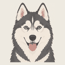 哈士奇 | 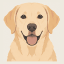 拉布拉多 | 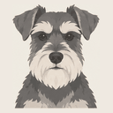 雪纳瑞 | 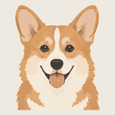 柯基 | 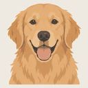 金毛 | 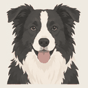 边牧 |
| 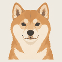 柴犬 | 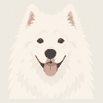 萨摩耶 | 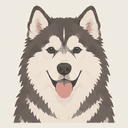 阿拉斯加 | 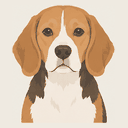 比格 | 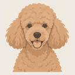 贵宾 | 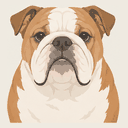 斗牛犬 |

**猫族 — 12 个品种**

| | | | | | |
|---|---|---|---|---|---|
| 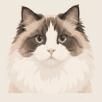 布偶 | 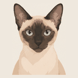 暹罗 | 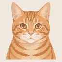 橘猫 | 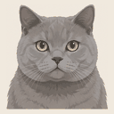 英短 | 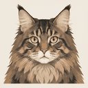 缅因 | 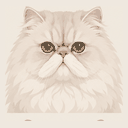 波斯 |
| 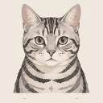 美短 | 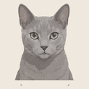 俄罗斯蓝猫 | 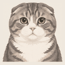 苏格兰折耳 | 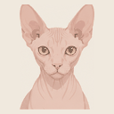 斯芬克斯 | 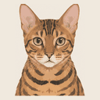 孟加拉豹猫 | 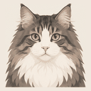 挪威森林猫 |

## 品种库说明

当前统一库包含两个品种族、24 个品种，每族 12 个成员：

| 品种族 | 标识 | 成员 |
|---|---|---|
| 犬族 | dog | 哈士奇、拉布拉多、雪纳瑞、柯基、金毛、边牧、柴犬、萨摩耶、阿拉斯加、比格、贵宾、斗牛犬 |
| 猫族 | cat | 布偶、暹罗、橘猫、英短、缅因、波斯、美短、俄罗斯蓝猫、苏格兰折耳、斯芬克斯、孟加拉豹猫、挪威森林猫 |

每个品种 36 条参考语料，来自 12 个环境各 3 条查询，两族合计 864 条。

待测样本 Clapt（clapt）不入库。它的权重向量由 0.80 份犬族基准与 0.20 份猫族基准混合而成，另叠加一个 111 处的峰。

参考语料由参数化生成器合成，生成过程不发网络请求。每个品种一条 355 维权重向量，权重由高斯峰、值域提升、末位数字偏置、位置漂移四项相乘得到，抽样时对每个位置按权重归一化后做 categorical 抽样。成员之间的差异用确定性相位扰动实现，同一个 seed 永远得到同一份语料。

两族的成员数都是 12，因此品种族概率可以直接比较。增加成员时两族必须同步增加，否则族概率的大小会反映成员数而不是相似度。

## DSH 插件

`dsh-plugin/` 把同一套归因搬进 DeepSeek Harness 的弹层，不出输入框就能出题、收答、判定。数学部分与下文一致，未作改动。

    dsh plugin --profile <你的 profile> add dsh-catdogtrace

装完重启 `dsh`：宿主要在启动时组装浏览器模块图。插件要求宿主支持客户端 bundle（`dsh >=0.2.1-rc.2`，`platform: web`）。

在输入框打 `/catdog`，选中 `/` 菜单候选。三种送数方式：

| 入口 | 贴什么 | 准入门槛 |
|---|---|---|
| 先出题 | 点「生成 3 道挑战」，把三条 prompt 分别交给待测模型，再把每份完整回复贴进同一序号的框 | 该道挑战的 `expected_count` |
| 裸文本 | 不出题，直接往框里贴 | 固定 80 |
| JSON | 折叠的 JSON 区贴 `{"outputs":[{"text":"...","expected_count":218}]}`，非空时优先于上面三个框 | 每条自带的值，缺 `expected_count` 按 80 |

点「判定」。结果给出两个品种族概率、冠军品种及其全局概率、24 品种的降序榜，以及被核心拒掉的每一份输入和它实际解析出的数字个数。`Esc`、`×` 按钮、点背景，三者任一关闭。

963KB 的指纹库是独立懒加载 chunk（`lib/client.unified_bank.js`），只在浮层第一次打开时取。

这是玩笑项目，不是研究工具：相似度分数不是谱系断言，两者之间那一步正是本仓库要摆出来的东西。见下文「现实检查」，内部实现见 [dsh-plugin/README.md](dsh-plugin/README.md)。

## 运行

    python3 -m pip install -r requirements.txt
    python3 start.py

页面地址为 http://127.0.0.1:7860/ 。设置环境变量 DOGCATTRACE_NO_BROWSER=1 可以阻止启动时自动打开浏览器。

完整流水共五步，按顺序执行：

    python3 enrollment.py --seed 20261017
    python3 bank_builder.py --responses data/dog_reference.jsonl --output data/dog_bank.json
    python3 bank_builder.py --responses data/cat_reference.jsonl --output data/cat_bank.json
    python3 rebuild_unified_bank.py
    python3 report.py

第一步生成两份合成参考语料。第二、三步分别拟合两个族的指纹库。第四步合并成统一全局库，同时写 data/unified_bank.json 与 static/data/unified_bank.json 两份逐字节相同的文件。第五步跑一次归因，产出 docs/归因报告.md。

跑测试：

    python3 -m pytest tests/

## 使用

- 手动测试：在页面复制三条挑战，分别交给同一个待测样本，再粘贴每次完整输出。
- 归因：页面提交三份输出，工具解析整数序列、提取指纹、在统一库上算出逐品种概率与品种族概率。
- 指纹库查看：页面可以读取当前统一库的模型名册、样本条数与校准参数。

单份输出至少需要解析出 80 个落在 1..355 的整数，否则该份不计入。低于三份有效输出时，工具用实际份数对应的校准温度，并在结果里标出实际用了几个查询。

## 指纹方法

### 核心算法

所有品种使用同一个全局特征空间、同一套特征与权重：

    0.75 × 去除环境方向后的 Hellinger 品种中心相似度
    + 0.25 × 有序块数字序列特征

每份输出先解析成整数序列，再算两个特征。边际特征是长度 355 的计数向量，做 α = 0.5 的 Hellinger 变换。有序特征把序列按位置切成 4 块，每块 16 个值域桶，再加末位数字分布，共 74 维，同样做 Hellinger 变换。

建库时用共享环境的平均偏移估计干扰方向。归因时先从两个特征里投影掉这些方向，再同时与全部品种中心做余弦相似度。三份回答分别评分后按类取平均，并使用与查询数量对应的校准温度转换为概率。

### 概率与品种族概率

具体品种概率由一次全局 softmax 得到，品种族概率是该族下各品种概率之和：

    P(具体品种) = softmax(β × 全局品种得分)
    P(品种族)   = Σ P(该族中的具体品种)

β 由分组交叉验证的负对数似然最小化搜索得到，搜索区间为 [0.05, 12.0]。

本次运行的校准结果如下，数值取自 docs/归因报告.md 的摘要表：

| 项 | 值 |
|---|---|
| 查询数 | 3 |
| 校准温度 β | 12.000000 |
| 交叉验证准确率 cv_accuracy | 98.26% |
| 入库品种数 | 24 |
| 入库样本条数 | 864 |

本次三次查询的 β 是 12.000000，打在搜索区间右端点上。1 次查询时不顶格，β 为 8.010150。

结果是当前候选库内、均匀先验下的闭集概率。未收录的样本仍会被归到最相似的现有候选。

### 对照组

均匀随机整数与库内任何品种都没有生成关系，归因流程照样给出很高的品种族概率。五个种子的实测结果见 docs/归因报告.md 的「对照组」一节。

## 项目结构

    app.py                   Web 接口
    start.py                 本地服务启动
    fingerprint.py           指纹提取与归因
    bank_builder.py          指纹库构建与概率校准
    challenge_suite.py       建库挑战套件
    enrollment.py            合成品种语料生成
    rebuild_unified_bank.py  重建统一全局库
    report.py                归因报告生成
    data/                    参考语料与指纹库
    docs/                    归因报告、靶子拆解、ADR
    static/                  页面资源
    templates/               页面模板
    tests/                   契约测试
    dsh-plugin/              DSH 客户端插件（/catdog 浮层）

挑战套件共 12 个环境，每个环境 3 条查询，合计 36 条。环境之间只改外层包装语（无包装、system 前缀、user 前缀）与目标计数，任务内容固定。

## 声明

测试结果仅供参考，并非判断品种来源的决定性证据。

本工具为归因工具，只对指纹库内的品种尽可能去判断属于哪一种，若待测样本不在指纹库中，得到任何结果都是有可能的。

结果是闭集概率。分母固定为库内候选数，因此任何输入都会得到一个看起来确定的答案，包括完全不在库内的输入。

概率的输入是数字分布的相似度。工具全程不读取训练数据、权重或来源记录。

报告里的每个百分号都来自一次真实运行，没有手写数值。重新跑 report.py 会得到与当次语料和 seed 对应的结果。

## 现实检查

把这种公式的输出的百分数当作蒸馏证据，是本项目要展示的那个笑话本身。

想先读一篇完整的长文，看这套东西为什么会给出自信的答案：[softmax 推不出蒸馏](docs/softmax-推不出蒸馏.md)。

这一节逐条拆解本工具复刻的四个推理动作。除本节与 docs/satire-targets.md 外，本仓库其余文件一律按上述方法描述。

先说一组实测。把与库内任何品种都无生成关系的均匀随机整数喂进同一个归因流程，五个种子的品种族概率落在 78.4612% 到 99.9999% 之间，判定结果两族都有。详见 docs/归因报告.md 的「对照组」一节。

### T1 概率的输入是数字分布的相似度

softmax 的输入是一条由随机数字算出的余弦相似度，输出被命名为概率。相似度不含来源信息：同一个提示词模板、同一个采样温度、同一个分词器、同一段包装语都能造成相似，两个独立来源也可能碰巧偏向同一批数字。

推理断在：从"数字分布像候选 A"到"样本由候选 A 产生"，中间没有任何一步被补上。工具全程没有接触训练数据、权重或蒸馏记录。

### T2 品种族概率是成员概率之和

品种族概率等于该族各成员概率之和。求和是加总，不是识别。一族有 12 个成员，另一族也有 12 个，份额大小反映的是成员概率的集中程度，与哪一族是源头没有逻辑通道。

求和还会把两种不同情形压成同一个数：某族里有一个成员特别像，和某族里每个成员都稍微像一点。本次运行里 斗牛犬 的归因概率为 63.72%，而犬族的品种族概率为 99.9999%，这两个数说的是不同的事。

推理断在：从"这一族成员概率之和最大"到"这一族是待测样本的祖先"，中间缺一步。

### T3 温度 β 的搜索上界

β 的搜索区间是 [0.05, 12.0]，801 个格点按对数等距。本仓库统一库的校准结果里，查询数为 1 的 β 为 8.010150，查询数为 2 和 3 的 β 都是 11.99999999999999。2 次和 3 次查询的 β 打在上界，说明最优值在区间之外，搜索被截断。

β 越大，softmax 越尖锐。β 趋近无穷时 softmax 退化成 one-hot，最大得分的候选拿走全部概率。当交叉验证正确率已经接近上限时，负对数似然仍会随 β 增大而下降，拟合过程会一路把 β 推到边界。于是概率的绝对大小由搜索区间的右端点决定，不由数据决定。

推理断在：把这样得到的百分比读成"把握程度"，等于把一个被区间上界截断的缩放因子读成置信度。本次运行三次查询用的 β 是 12.000000，正是这个上界。

### T4 闭集与均匀先验

候选集是有限且事先固定的 24 个品种。softmax 的分母只在这 24 个候选上归一化，因此 24 个概率加起来一定是 1。库外样本也会被归到最相似的那一个上，拿到一个看起来像概率的数。分母里没有"以上都不是"这一项。

均匀先验意味着 24 个候选事先被当成一样可能。真实场景里品种流行度、版本迭代关系、族内成员数都会让先验不均等，这些信息一律不参与计算。

cv_accuracy 衡量的是库内自我识别：按环境分组、按查询留出，看留出的那些样本能否被认回它自己的品种。本次运行的三查询 cv_accuracy 为 98.26%。这个数只说明库内样本能被认回自己，不涉及库外样本。

推理断在：从"在这 24 个候选里 A 最像"到"这个样本就是 A"，中间缺一条。闭集假设把缺口藏起来了，因为分母一定是 24，任何输入都会得到一个看起来很确定的答案。

### 四条靶子的共同结构

四条靶子是同一个动作的四次重演：算一个相似度或求和，用一个可能被区间截断的缩放因子把它放大，在一个封闭候选集上归一化，最后把得到的小数命名为概率并读成因果断言。

每一步单独看都站得住。断的地方在最后一步：从相似到同源，没有任何一步被补上。

逐条展开见 docs/satire-targets.md。四个术语的准确用法见 GLOSSARY.md。

## 友链

- [LINUX DO](https://linux.do/)
